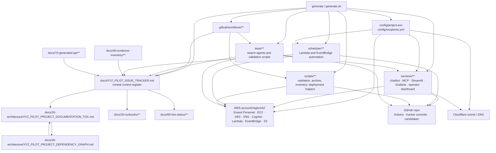

# Project Dependency Graph

This document describes how project documents, runtime modules, GitHub
automation, candidates, and evidence artifacts depend on each other.

The Mermaid graph is intentionally simple so it renders in Streamlit surfaces
and chatbot responses.

## Update Discipline

Update this graph whenever any of these change:

- Runtime service boundaries.
- GitHub workflow read/write paths.
- Tracker candidate flow.
- AWS service ownership.
- Documentation folder structure.
- Evidence or test-output locations.
